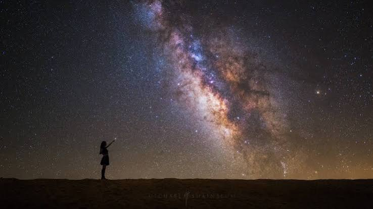

# 🌌 Foton Vibe

<p align="center">
  
</p>

<p align="center">
  <strong>Çevrimdışı Öncelikli (Offline-First) Mobil Astrofotografi Asistanı & Kozmik Yol Arkadaşı</strong>
</p>

<p align="center">
  <a href="https://github.com/VelliDR/foton-vibe/actions/workflows/deploy.yml">
    
  </a>
  
  
  
  
  
</p>

<p align="center">
  <a href="https://vellidr.github.io/foton-vibe/"><strong>Canlı PWA Uygulamasını Aç ➔</strong></a>
</p>

---

## 📖 Felsefe & Vizyon

**Foton Vibe**; elektriğin, baz istasyonunun ve internetin olmadığı zifiri karanlık dağ başlarında, krater kenarlarında veya ücra yaylalarda astrofotograflara rehberlik etmek üzere inşa edilmiştir.

Özellikle eski Sovyet optiklerinin (efsanevi 1984 **Helios 44M-4** gibi) o kusurlu ama organik girdap bokeh karakterini arayan, gökyüzünü salt bir matematiksel piksel matrisi değil, felsefi bir tuval olarak gören fotoğrafçılar için sıfır gecikmeli bir saha yol arkadaşıdır.

> [!NOTE]
> **Tamamen Çevrimdışı (100% Offline-First):** Tüm astronomik koordinatlar, alacakaranlık pencereleri, Ay evreleri ve NPF pozlama formülleri yerel cihaz üzerinde derlenmiş matematiksel motorlarla hesaplanır.

---

## 📸 Temel Özellikler

### 1. 🌌 Gösterge Paneli (Dashboard & Astrometri)
* **Astronomik Zaman & Karanlık Penceresi:** NASA/JPL standartlarındaki `astronomy-engine` ile Güneş batımını, Samanyolu ve derin uzay için en kritik eşik olan **Astronomik Karanlık (-18°)** başlangıcını ve sabah alacakaranlık bitişini hesaplar. Toplam kesintisiz karanlık süresini dakika hassasiyetinde verir.
* **Dinamik Ay İrtifası ve Doğuş/Batış:** Ay'ın gökyüzündeki gerçek zamanlı irtifasını (altitude), pusula yönünü (azimuth), anlık aydınlanma yüzdesini ve o günkü doğuş/batış saatlerini sunar.
* **Gerçekçi Hibrit Bortle Simülasyonu:** Ay ufkun altındayken gökyüzünü kirletmez. Ay doğduğunda ise gökteki yüksekliğine ve evresine göre ışık kirliliği puanını (Bortle 1-9) dinamik olarak kalibre eder.
* **🔭 Zengin Kozmik Katalog (10 Hedef) & Filtreler:**
  - 🌌 *Samanyolu Çekirdeği (Yay A\*)*
  - 🌀 *Andromeda Galaksisi (M31)*
  - 🌺 *Orion Bulutsusu (M42)*
  - ✨ *Ülker Açık Kümesi (Pleiades - M45)*
  - ⭐ *Kutup Yıldızı (Polaris)*
  - 🌙 *Ay* & 🪐 *Jüpiter* & 🪐 *Satürn*
  - 💎 *Vega* & 🌟 *Sirius*
  - Canlı kategori filtreleme (`Tümü`, `Derin Uzay`, `Gezegen/Ay`, `Yıldız`) ve ufkun üstündeki hedefleri en tepede gösteren akıllı sıralama.
* **🧭 Canlı Pusula & Gökyüzü Radarı (`DeviceOrientation`):** Cihazı göğe doğrulttuğunda anlık pusula yönünü, eğim açısını ve ana yönü göstererek hedef bulmayı kolaylaştırır.

---

### 2. ⏱️ Gelişmiş Pozlama & Saha Laboratuvarı
* **Gelişmiş NPF Kuralı:** Yıldızların uzamasını (star trailing) engellemek için sensör mikron boyutu, odak uzaklığı, diyafram ve göksel sapma (declination) açılarını hesaba katan bilimsel formülü uygular.
* **⚖️ 500 Kuralı vs. NPF Kıyaslaması:** Eski 500 kuralının yüksek megapikselli sensörlerde yarattığı uzama riskini NPF ile kıyaslayarak gösterir.
* **🎯 Hızlı Ekipman Ön Tanımları (Preset):** Sony A7 serisi, Canon R/Rebel serisi, Fuji X-T, M43 gövdeler ile Helios 44M, Jupiter-9, Samyang 14mm f/2.8, Samyang 135mm f/2.0 gibi efsane lensleri tek tıkla yükler.
* **Aşırı Pozlama Koruması (Overexposure Protection):** Işık kirliliği olan yerlerde tek karenin patlamasını engeller; güvenli alt sürelere bölerek istifleme (stacking) reçetesi sunar.
* **⏱️ Saha Deklanşör Zamanlayıcısı (Intervalometer):**
  - Web Audio API ile harici mp3 gerektirmeyen mekanik deklanşör sesleri sentezler.
  - Titreşim (Vibration API) haptic geri bildirimiyle karanlıkta ekrana bakmadan pozlama başlangıç ve bitişini hissettirir.
  - Kare sayısı, pozlama süresi ve tampon bellek dinlenme aralığını sayar.
* **📋 Kalibrasyon Kareleri Kontrol Listesi:** Sahadan dönmeden önce Light, Dark, Flat ve Bias karelerinin eksiksiz alınmasını garanti eden interaktif kontrol listesi.

---

### 3. 🔴 Saha Ergonomisi & Donanım Araçları
* **Saf OLED Kırmızı Gece Modu:** Tek tıkla tüm ekranı saf siyah (`#000000`) ve monokrom kırmızıya (`#FF2B2B`) geçirir; fotoğrafçının göz adaptasyonunu (rodopsin) korur.
* **🔆 Ekranı Açık Tutma (Screen Wake Lock API):** Çekim beklerken veya üçayak kurarken ekranın kapanıp telefonun kilitlenmesini önler.
* **✍️ Foton Esintisi (Vibe):** Günün zaman dilimine ve kozmik saate göre değişen felsefi kompozisyon fikirleri ve sanatsal hatırlatıcılar sunar.
* **📍 Rota Keşif Dedektörü:** Overpass API (OSM) üzerinden 5 km çevrendeki tarihi kalıntıları, harabeleri ve tepe noktalarını tarar.

---

## 🛠️ Teknik Mimari

| Katman | Teknoloji | Amaç |
| :--- | :--- | :--- |
| **Dil** | **TypeScript 5.7** | Tip güvenliği, sıfır `NaN` / runtime hatası |
| **Derleyici** | **Vite 6** | Anında HMR, 170ms üretim derlemesi |
| **Tasarım** | **Tailwind CSS v4** | Derlenmiş sıfır-CDN mimarisi, 14 KB minified CSS |
| **PWA Motoru** | **vite-plugin-pwa (Workbox)** | Otomatik precache, varlık hash'leme, kusursuz çevrimdışı çalışma |
| **Astrometri** | **astronomy-engine** | NASA standartlarında Güneş, Ay ve Gezegen efemerisleri |
| **Donanım API'leri** | **WakeLock, DeviceOrientation, Web Audio, Vibration** | Saha ergonomisi ve canlı fiziksel sensörler |
| **Test** | **Vitest** | Astronomik matematik ve pozlama algoritmaları için birim testleri |

---

## 🚀 Yerel Geliştirme ve Çalıştırma

Projeyi bilgisayarınızda yerel olarak çalıştırmak son derece basittir:

```bash
# 1. Depoyu klonlayın
git clone https://github.com/VelliDR/foton-vibe.git
cd foton-vibe

# 2. Bağımlılıkları yükleyin
npm install

# 3. Sıcak yenilemeli (HMR) geliştirme sunucusunu başlatın
npm run dev

# 4. Birim testlerini çalıştırın
npm test

# 5. Üretim paketi derleyin
npm run build

# 6. Üretim derlemesini yerelde önizleyin
npm run preview
```

---

## 📲 PWA Olarak Telefona Yükleme

1. Mobil tarayıcınızda (Chrome veya Safari) **[https://vellidr.github.io/foton-vibe/](https://vellidr.github.io/foton-vibe/)** adresini açın.
2. Tarayıcı menüsünden **"Ana Ekrana Ekle"** veya **"Uygulama Olarak Yükle"** seçeneğine dokunun.
3. Artık internet bağlantınız olmasa bile dağ başında doğrudan ana ekranınızdan bağımsız bir yerel uygulama gibi kullanabilirsiniz.

---

## 📄 Lisans

Bu proje [MIT Lisansı](LICENSE) kapsamında açık kaynak olarak geliştirilmiştir. Gökyüzü herkesindir. 🌌
